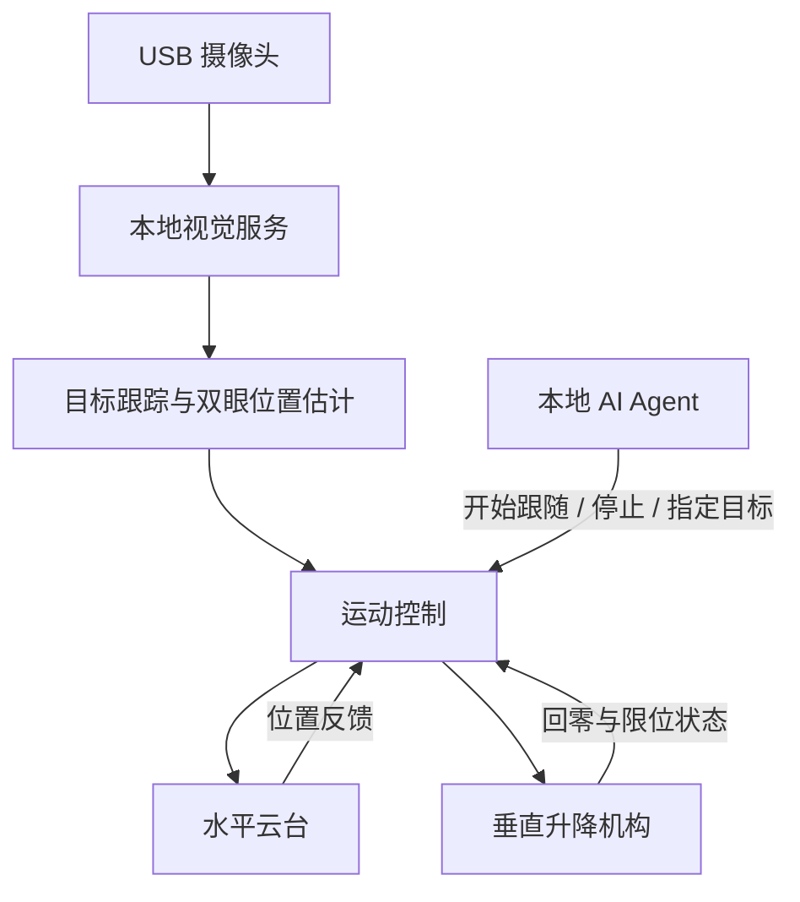

# EyeLevel AgentCam

**面向 AI Agent 的具身视觉摄像头。**

An embodied vision camera project for AI agents, designed to combine motorized pan, vertical lift, and face tracking for eye-level interaction.

EyeLevel AgentCam 将视觉感知与机械运动结合，让摄像头能够主动调整位置和朝向。项目计划通过人脸与眼部位置跟踪，控制水平云台和垂直升降机构，使镜头尽量保持在人眼高度，为本地 AI Agent 提供可移动的视觉入口。

> **项目状态：早期开发中。**
> 已提供本地相机人脸检测与调整建议程序；电机控制仍为拟定方案。硬件选型、接口和目录结构可能随开发调整。

## 运行人脸检测与调整建议

Python 3.10+，在项目目录执行（Windows PowerShell）：

```powershell
python -m venv .venv
.\.venv\Scripts\python.exe -m pip install -r requirements.txt
.\.venv\Scripts\python.exe src\agentcam.py
```

程序持续读取默认相机（编号 0），第一帧处理完成后立即输出，随后每 3 秒输出最新检测结果。图像只在本机内存处理，不保存照片或录像。按 `Ctrl+C` 结束并释放相机。

已有 Conda 环境且安装了 OpenCV 时，可以直接运行 `python src\agentcam.py --preview`。程序兼容 pip 的 `cv2.data.haarcascades` 和 Conda 的 `Library/etc/haarcascades` 等模型目录。不要用 pip 强行覆盖 Conda 管理的 OpenCV；出现 `uninstall-no-record-file` 表示 pip 没有该 Conda 包的卸载记录，并非检测接口不可用。

```text
[本地时间] 检测到人脸：1 张 | 整体高度：向上升高 | 云台：向左转 | 参考：双眼中点 | 偏差：水平 -20.0%，垂直 -15.0%
[本地时间] 未检测到人脸 | 整体高度：保持 | 云台：保持 | 无法判断目标方向，不建议盲目左右摇摆
```

可选参数示例：

```powershell
# 实时预览：绿色框为选中的人脸，圆点为跟踪参考，黄色框为中心容差
.\.venv\Scripts\python.exe src\agentcam.py --preview
# 多个摄像头时手动指定编号；被其他软件占用时请先关闭该软件
.\.venv\Scripts\python.exe src\agentcam.py --camera 1
# 运行 12 秒自动退出，或调整中心容差
.\.venv\Scripts\python.exe src\agentcam.py --duration 12
.\.venv\Scripts\python.exe src\agentcam.py --deadzone-x 0.08 --deadzone-y 0.06
# Windows 默认使用 DirectShow；打不开相机时尝试其他后端
.\.venv\Scripts\python.exe src\agentcam.py --backend msmf
```

预览窗口按 `Q`、`Esc` 或关闭窗口退出。终端输出中文，预览标注为英文。默认无预览，可用于没有图形界面的环境。Linux/macOS 使用 `.venv/bin/python` 启动；Windows 特有的 `dshow`、`msmf` 后端不适用于这些系统。

调整建议的含义：

- 假定镜头固定水平、图像未镜像也未旋转。目标在画面左侧时云台向左转，在右侧时向右转；双眼高于画面中心时整体升高，低于中心时整体降低。上下移动指升降机构，不是镜头俯仰。
- 默认容差为中心左右各画面宽度的 8%、上下各画面高度的 6%。两个轴独立判断，可同时建议升降和转向。偏差是整幅画面的比例，水平向右、垂直向下为正。
- 优先以检测到的双眼中点判断；未检测到双眼时使用人脸框内约 40% 高度处估计眼高，输出会标注“眼高估计”。这属于粗略建议，不是精确眼部关键点定位。
- 多人时首次选最大人脸，后续优先选择与上一帧框重叠的目标，丢失后重新选择。不识别身份，也不保证多人交叉时保持同一人。
- 未检测到人脸时保持；这不等于确认画面无人。读取失败时输出“未知”，连续 10 次失败后退出，不沿用旧画面的运动建议。
- 本版采用 OpenCV 自带的 Haar 人脸/眼部模型，无需另下模型。侧脸、遮挡、逆光、小人脸会影响检测效果。检测方法参考 [OpenCV 官方文档](https://docs.opencv.org/4.11.0/db/d28/tutorial_cascade_classifier.html)。
- 程序只输出方向，不发送电机指令。未经镜头姿态、视场和距离标定，不能由单帧准确给出升降厘米数或转动角度。输出间隔按单调时钟调度，实际时间受相机读取和检测耗时影响。

如果相机无法打开，检查设备编号、连接、其他相机应用占用，以及 Windows“隐私和安全性 → 相机 → 允许桌面应用访问相机”。预览需要 `opencv-python`，不要在同一个虚拟环境里混装 `opencv-python-headless`。测试命令：

```powershell
.\.venv\Scripts\python.exe -m unittest discover -s tests -v
```

## 在 VS Code 中识别和控制 Arduino UNO R3

使用 USB-B 数据线连接 UNO 和 PC。可以先用板载 `L` 灯验证通信，无需接电机或额外的 12V 电源。固件还支持 28BYJ-48 + ULN2003 的手动点动，尚未接入相机自动跟随。

在 VS Code 中打开本项目文件夹，按 `Ctrl+Shift+P`，选择 **Tasks: Run Task（任务：运行任务）**，按顺序执行：

| 任务 | 作用 |
| --- | --- |
| `Arduino: Setup tools` | 首次安装工具到项目 `.venv-arduino`，不修改当前 Conda 环境 |
| `Arduino: List ports` | 显示串口、USB VID/PID 等信息，不打开串口 |
| `Arduino: Build` | 编译 UNO 固件，首次需联网下载 AVR 工具链 |
| `Arduino: Upload` | 输入确认后的串口编号，编译并将测试固件写入 UNO，替换板上原程序 |
| `Arduino: Verify connection and LED` | 握手、开灯 1 秒、检查状态、关灯，输出 `PASS` |
| `Arduino: Control motor and LED` | 交互控制电机和灯；`q` 停止并释放电机、关灯、退出 |

当前机器检测到的 UNO USB ID 为 `2341:0043`，端口为 `COM3`。换 USB 接口或换电脑后编号可能改变，应重新运行 List ports；可拔插 USB 比较端口列表。设备名称可能仅为“USB 串行设备”，不一定显示 Arduino。COM5/COM6 等蓝牙端口不是该 UNO。

这些任务使用项目内的 PlatformIO Core，不要求安装 Arduino IDE 或 VS Code 扩展。需要 C++ 智能提示、PlatformIO 图形界面时，可另装官方 **PlatformIO IDE** 扩展并打开同一项目。配置见 `platformio.ini`，固件见 `firmware/uno_serial/src/main.cpp`。

也可以直接在 VS Code 的 PowerShell 终端执行：

```powershell
# 首次安装工具
powershell -NoProfile -ExecutionPolicy Bypass -File scripts\setup_arduino.ps1
# 查看设备
.\.venv-arduino\Scripts\python.exe src\arduino_control.py --list
# 编译并上传（将 COM3 换成实际端口）
.\.venv-arduino\Scripts\python.exe -m platformio run -e uno -t upload --upload-port COM3
# 验证通信和板载灯
.\.venv-arduino\Scripts\python.exe src\arduino_control.py --port COM3 --smoke-test
# 交互控制
.\.venv-arduino\Scripts\python.exe src\arduino_control.py --port COM3
```

正常握手会返回 `PONG AGENTCAM UNO 2`。波特率为 115200，命令使用 ASCII，以换行结束。固件接受 `PING`、`LED ON`、`LED OFF`、`STATUS`、`MOVE N`、`STOP`、`MOTOR STATUS`，其他命令会返回错误。PC 脚本只在握手确认本项目固件之后发送控制指令。原来的版本 1 固件需要重新上传。

打开串口通常会使 UNO 复位，因此脚本等待 2 秒；交互模式会保持同一次连接，适合观察灯的连续变化。单条命令可用 `--command on` / `off` / `status` / `ping`，但下一次运行重新打开串口可能复位并清除上一轮的 LED 状态。

如果提示串口被占用，先退出控制脚本、关闭 Arduino/PlatformIO 串口监视器再上传；上传和控制不能同时占用同一端口。若没有 USB 串口，检查数据线，在 Windows 设备管理器查看“端口 (COM 和 LPT)”及未知设备；兼容板的驱动类型以实际 USB 芯片/硬件 ID 为准。

参考：[PlatformIO 项目配置](https://docs.platformio.org/en/stable/projectconf/index.html)、[指定上传端口](https://docs.platformio.org/en/stable/projectconf/sections/env/options/upload/upload_port.html)。

### 28BYJ-48 电机点动

控制接线固定为 **IN1→D8、IN2→D9、IN3→D10、IN4→D11**，驱动板 GND 与 UNO GND 共地。电机由匹配额定电压的外接电源供电，UNO 使用 USB 供电。驱动板电源端和跳线应按具体板型说明连接，不应仅凭线色判断正负极。

先运行 `Arduino: Upload` 上传当前固件，再运行 `Arduino: Control motor and LED`，输入端口（本机此前是 COM3）。终端命令如下：

| 输入 | 行为 |
| --- | --- |
| `cw` | 正向点动 128 个半步，约 0.5 秒 |
| `ccw` | 反向点动 128 个半步，约 0.5 秒 |
| `move 512` | 正向点动 512 个半步，约 2 秒 |
| `move -512` | 反向点动 512 个半步，约 2 秒 |
| `stop` | 停止并释放线圈 |
| `motor` | 查询软件运动状态和剩余半步数 |
| `q` | 停止、释放线圈、关闭 L 灯并退出 |

`cw`/`ccw` 是正反向命令别名，实际观察到的顺逆时针与观察轴端、接线有关。每次运动仅接受 -512～512 的非零整数半步数；以约 4096 半步/圈估算，128 半步约 11°、512 半步约 45°，不是经过标定的角度。忙时拒绝新运动，不排队；可先输入 `stop`。固件每 4ms 换相，采用非阻塞八拍半步序列，启动时所有控制输出为低。

每次动作完成后自动释放线圈，固件还有 3 秒动作上限。停止命令在同一串口连接内发送；PC 进程异常退出或 USB 断开不会被立即感知，但不会持续无限运动。若需要立即切断电机动力，应断开其外接电源。

这是空载台架点动程序，没有回零、限位、编码器或抱闸控制，释放线圈后不保持负载位置，不用于承重升降。`OK MOVE N` 仅表示固件接受了指令，`MOTOR IDLE 0` 表示软件完成或停止，均不证明电机实际转过指定角度。自动 LED 验证不会驱动电机。

直接使用终端时，启动交互控制：

```powershell
.\.venv-arduino\Scripts\python.exe src\arduino_control.py --port COM3
```

也可以运行一次有界动作，脚本会等动作结束并发送停止后退出：

```powershell
.\.venv-arduino\Scripts\python.exe src\arduino_control.py --port COM3 --command "move 128"
```

## 项目目标

传统固定摄像头难以适应用户坐下、站起或左右移动时的位置变化。EyeLevel AgentCam 希望通过两个运动自由度改善这一问题：

- **水平旋转**：调整摄像头朝向，使目标人脸保持在画面中央附近。
- **垂直升降**：调整镜头的实际高度，使其与用户双眼近似同高。

摄像头俯仰角固定为水平。系统以双眼中点作为跟踪参考，通过视觉反馈持续调整运动。

本项目中的“平视”指镜头高度与用户双眼高度近似一致，不代表用户正在注视镜头，也不要求识别用户身份。

## 计划功能

- [x] 本地 USB 摄像头采集与预览
- [x] 每 3 秒输出人脸检测与升降 / 云台方向建议
- [ ] 人脸检测与眼部关键点定位
- [ ] 同一目标的连续跟踪
- [ ] 水平云台角度控制与位置反馈
- [ ] 垂直升降控制、回零与行程限制
- [ ] 基于视觉误差的双轴联动
- [ ] 运动平滑、速度限制与中心死区
- [ ] 人脸丢失及通信超时处理
- [ ] 本地 Agent 控制接口
- [ ] 硬件安装、接线与标定文档

## 工作原理



系统拟分为三个层次：

| 层次 | 主要职责 |
| --- | --- |
| Agent 层 | 决定何时跟随、停止或切换任务 |
| 视觉与控制层 | 处理图像、跟踪目标、计算运动指令 |
| 硬件执行层 | 执行电机运动、检测限位、处理通信超时 |

实时运动闭环由专门的控制程序运行。Agent 通过高层接口发出任务指令，不需要逐帧生成电机脉冲。

## 平视控制思路

1. 检测目标人脸，估计双眼中点。
2. 计算双眼中点与校准后画面中心的水平、垂直偏差。
3. 根据水平偏差调整云台方向。
4. 根据垂直偏差调整升降高度。
5. 当偏差进入允许范围时停止调整，减少细小动作引起的抖动。

实现这一控制需要先校准摄像头水平姿态、旋转轴方向和图像中心偏差。

跟踪效果受光照、遮挡、摄像头视野、目标运动速度及机械行程影响。系统无法保证在所有位置和动作下持续平视。

## 硬件方案

以下为第一版原型的拟定配置，尚需进行装配和实机验证。

| 模块 | 拟定选型 | 用途 |
| --- | --- | --- |
| 本地计算 | 现有电脑 | 运行 Agent、视觉服务及控制程序 |
| 摄像头 | Logitech C920s 或兼容 USB 摄像头 | 图像采集 |
| 水平执行器 | Waveshare ST3215，12 V 版本 | 左右旋转 |
| 舵机接口 | Waveshare Bus Servo Adapter (A) | USB 转总线舵机控制 |
| 升降机构 | 1605 丝杆直线模组，有效行程约 800 mm | 垂直移动 |
| 升降电机 | 带断电抱闸的 NEMA23 步进电机 | 驱动升降并保持位置 |
| 步进驱动器 | DM556T | 驱动升降电机 |
| 升降控制板 | Arduino UNO R3 | 脉冲输出、限位检测及抱闸时序 |
| 配套组件 | 上下限位、急停、独立电源、固定支架 | 运动约束、供电及结构固定 |

最终配置应根据移动负载、安装尺寸、供电条件和目标速度确认。具体接线以实际型号的厂商文档及后续验证记录为准。

## 开发环境

拟采用：

- Python：图像采集、目标跟踪与上位机控制
- Arduino / C++：升降控制固件
- USB 串口：电脑与控制硬件之间的通信
- Git 与 GitHub：版本管理和协作

视觉程序的依赖见 `requirements.txt`，安装与启动方式见上文。硬件控制固件尚未实现。

## 获取项目

```bash
git clone https://github.com/AaronGuo0301/eyelevel-agentcam.git
cd eyelevel-agentcam
```

当前可以运行上文的视觉建议程序；完整机械控制和标定流程仍待实现与验证。

## 开发路线

### 阶段一：视觉基础

- 获取摄像头图像并显示预览
- 检测人脸与双眼位置
- 验证连续跟踪和目标丢失处理

### 阶段二：单轴控制

- 完成水平云台控制与反馈读取
- 完成升降回零、限位和抱闸控制
- 分别验证运动方向、范围与停止行为

### 阶段三：双轴联动

- 将视觉偏差转换为运动指令
- 加入死区、滤波和速度限制
- 验证不同高度与左右位置下的跟踪效果

### 阶段四：Agent 接入

- 定义跟随、停止和状态查询接口
- 接入本地 Agent
- 完善使用文档与演示

## 调试与数据管理

- 初次调试应以低速、有限行程分别验证各轴。
- 垂直机构应验证断电保持、上下限位及急停行为。
- 控制器应独立处理通信超时，避免依赖 Agent 响应完成停止。
- 软件变更后，应重新验证受影响的运动行为。
- API 密钥、本地环境配置、未经授权的人脸图像和录像不应提交到仓库。
- 大型模型和数据文件应通过适当的外部存储或大文件管理方式提供。

## 参与贡献

欢迎通过 Issues 提交问题、建议和实验结果。

建议的贡献流程：

1. 为较大的功能或结构调整先创建 Issue。
2. 在独立分支上开发。
3. 提交范围清楚的修改。
4. 在 Pull Request 中说明修改目的、验证方法和已知限制。

硬件相关贡献请注明设备型号、固件版本、接线差异及实测条件。未经实机验证的内容请明确标注。

## 许可证

项目授权条款以仓库中的 `LICENSE` 文件为准。第三方代码、模型和硬件设计遵循其各自的许可。
