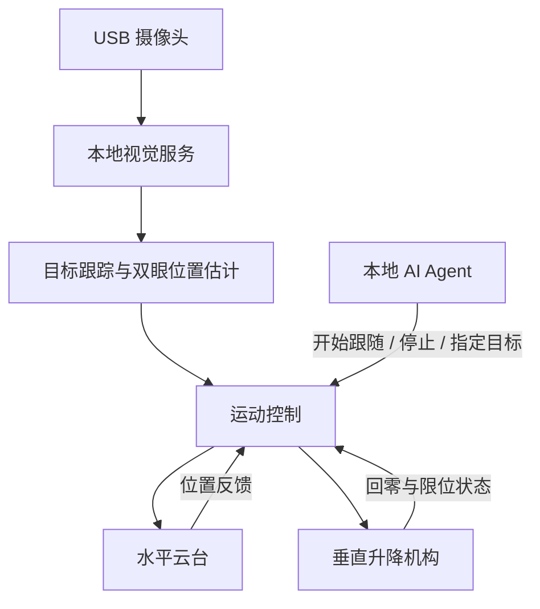

# EyeLevel AgentCam

**面向 AI Agent 的具身视觉摄像头。**

An embodied vision camera project for AI agents, designed to combine motorized pan, vertical lift, and face tracking for eye-level interaction.

EyeLevel AgentCam 将视觉感知与机械运动结合，让摄像头能够主动调整位置和朝向。项目计划通过人脸与眼部位置跟踪，控制水平云台和垂直升降机构，使镜头尽量保持在人眼高度，为本地 AI Agent 提供可移动的视觉入口。

> **项目状态：早期开发中。**
> 本文介绍项目目标与拟定方案，不代表相关功能已经完成或通过实机验证。硬件选型、接口和目录结构可能随开发调整。

## 项目目标

传统固定摄像头难以适应用户坐下、站起或左右移动时的位置变化。EyeLevel AgentCam 希望通过两个运动自由度改善这一问题：

- **水平旋转**：调整摄像头朝向，使目标人脸保持在画面中央附近。
- **垂直升降**：调整镜头的实际高度，使其与用户双眼近似同高。

摄像头俯仰角固定为水平。系统以双眼中点作为跟踪参考，通过视觉反馈持续调整运动。

本项目中的“平视”指镜头高度与用户双眼高度近似一致，不代表用户正在注视镜头，也不要求识别用户身份。

## 计划功能

- [ ] 本地 USB 摄像头采集与预览
- [ ] 人脸检测与眼部关键点定位
- [ ] 同一目标的连续跟踪
- [ ] 水平云台角度控制与位置反馈
- [ ] 垂直升降控制、回零与行程限制
- [ ] 基于视觉误差的双轴联动
- [ ] 运动平滑、速度限制与中心死区
- [ ] 人脸丢失及通信超时处理
- [ ] 本地 Agent 控制接口
- [ ] 硬件安装、接线与标定文档

## 工作原理



系统拟分为三个层次：

| 层次 | 主要职责 |
| --- | --- |
| Agent 层 | 决定何时跟随、停止或切换任务 |
| 视觉与控制层 | 处理图像、跟踪目标、计算运动指令 |
| 硬件执行层 | 执行电机运动、检测限位、处理通信超时 |

实时运动闭环由专门的控制程序运行。Agent 通过高层接口发出任务指令，不需要逐帧生成电机脉冲。

## 平视控制思路

1. 检测目标人脸，估计双眼中点。
2. 计算双眼中点与校准后画面中心的水平、垂直偏差。
3. 根据水平偏差调整云台方向。
4. 根据垂直偏差调整升降高度。
5. 当偏差进入允许范围时停止调整，减少细小动作引起的抖动。

实现这一控制需要先校准摄像头水平姿态、旋转轴方向和图像中心偏差。

跟踪效果受光照、遮挡、摄像头视野、目标运动速度及机械行程影响。系统无法保证在所有位置和动作下持续平视。

## 硬件方案

以下为第一版原型的拟定配置，尚需进行装配和实机验证。

| 模块 | 拟定选型 | 用途 |
| --- | --- | --- |
| 本地计算 | 现有电脑 | 运行 Agent、视觉服务及控制程序 |
| 摄像头 | Logitech C920s 或兼容 USB 摄像头 | 图像采集 |
| 水平执行器 | Waveshare ST3215，12 V 版本 | 左右旋转 |
| 舵机接口 | Waveshare Bus Servo Adapter (A) | USB 转总线舵机控制 |
| 升降机构 | 1605 丝杆直线模组，有效行程约 800 mm | 垂直移动 |
| 升降电机 | 带断电抱闸的 NEMA23 步进电机 | 驱动升降并保持位置 |
| 步进驱动器 | DM556T | 驱动升降电机 |
| 升降控制板 | Arduino UNO R3 | 脉冲输出、限位检测及抱闸时序 |
| 配套组件 | 上下限位、急停、独立电源、固定支架 | 运动约束、供电及结构固定 |

最终配置应根据移动负载、安装尺寸、供电条件和目标速度确认。具体接线以实际型号的厂商文档及后续验证记录为准。

## 开发环境

拟采用：

- Python：图像采集、目标跟踪与上位机控制
- Arduino / C++：升降控制固件
- USB 串口：电脑与控制硬件之间的通信
- Git 与 GitHub：版本管理和协作

具体依赖版本、支持的操作系统和启动命令将在首个可运行版本中补充。

## 获取项目

```bash
git clone https://github.com/AaronGuo0301/eyelevel-agentcam.git
cd eyelevel-agentcam
```

目前尚未提供经过验证的完整安装与启动流程。请以仓库实际代码、后续文档和发布说明为准。

## 开发路线

### 阶段一：视觉基础

- 获取摄像头图像并显示预览
- 检测人脸与双眼位置
- 验证连续跟踪和目标丢失处理

### 阶段二：单轴控制

- 完成水平云台控制与反馈读取
- 完成升降回零、限位和抱闸控制
- 分别验证运动方向、范围与停止行为

### 阶段三：双轴联动

- 将视觉偏差转换为运动指令
- 加入死区、滤波和速度限制
- 验证不同高度与左右位置下的跟踪效果

### 阶段四：Agent 接入

- 定义跟随、停止和状态查询接口
- 接入本地 Agent
- 完善使用文档与演示

## 调试与数据管理

- 初次调试应以低速、有限行程分别验证各轴。
- 垂直机构应验证断电保持、上下限位及急停行为。
- 控制器应独立处理通信超时，避免依赖 Agent 响应完成停止。
- 软件变更后，应重新验证受影响的运动行为。
- API 密钥、本地环境配置、未经授权的人脸图像和录像不应提交到仓库。
- 大型模型和数据文件应通过适当的外部存储或大文件管理方式提供。

## 参与贡献

欢迎通过 Issues 提交问题、建议和实验结果。

建议的贡献流程：

1. 为较大的功能或结构调整先创建 Issue。
2. 在独立分支上开发。
3. 提交范围清楚的修改。
4. 在 Pull Request 中说明修改目的、验证方法和已知限制。

硬件相关贡献请注明设备型号、固件版本、接线差异及实测条件。未经实机验证的内容请明确标注。

## 许可证

项目授权条款以仓库中的 `LICENSE` 文件为准。第三方代码、模型和硬件设计遵循其各自的许可。